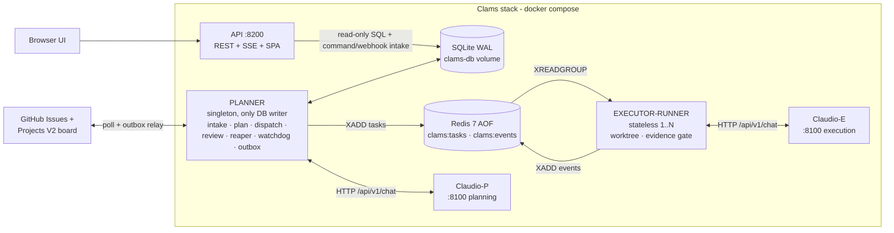

# Clams v2 — Planner–Executor orchestrator for Claudio

Clams turns GitHub Issues / Projects V2 boards into a durable work queue and
drives two Claudio agent backends — a **Planner** (plan generation) and an
**Executor** (headless task work in isolated git worktrees). Clams' Python
planner validates plans and makes workflow review decisions from task state and
evidence; its Python executor-runner coordinates agent execution. A web UI
provides supervision. One SQLite DB, two Redis work/event streams, and an
auxiliary dead-letter stream.

The authoritative design spec lives in
[massimorofi/clams#130](https://github.com/massimorofi/clams/issues/130)
(CLAMS v2 Super Plan); the backup of the pre-refactor code is tagged
`CLAMS_0_0_1_old`.

## Documentation

| Doc | Contents |
|---|---|
| [Quickstart](doc/quickstart.md) | Install, `.env` configuration, ports & addresses, **token setup incl. the UI**, first run |
| [clamsctl reference](doc/clamsctl.md) | Every operator command and its parameters |
| [System architecture](doc/system_architecture.md) | Current Compose topology, container roles, executor layers, communication paths, and persistent volumes |
| [Deployment & state machines](doc/deployment.md) | Docker topology, services, volumes, healthchecks, scaling, **workflow & task state machines**, leases, watchdog, operations |
| [GitHub setup](doc/github.md) | Token/credential scopes, Projects V2 kanban board setup, intake gestures, projection rules |
| [Workflow recovery runbook](doc/workflow-recovery.md) | Recovering a blocked/failed workflow with one `recover` command: orphan + stale-success sweeps, replan from the last successful step, idempotency & audit trail |

## Architecture at a glance



Five invariants (enforced and tested):

1. **Single writer** — only the planner mutates workflow/task domain state; the
   API reads state and queues commands (including validated webhook deliveries).
2. **DB is truth, queues are transport** — losing Redis loses no work.
3. **Every side-effect via outbox** — no GitHub call or XADD inside a business
   transaction.
4. **Evidence beats claims** — task success = deterministic gate pass
   (`run:` commands exit 0, ≥1 commit, scope respected, clean tree), never
   model text.
5. **Work is bounded** — attempts, agent turns, replans, plan size, outbox
   retries, and LLM calls per cycle have configured bounds.

## Quick start (short version)

```bash
git clone https://github.com/massimorofi/clams && cd clams
cp .env.example .env                 # then set the tokens (see Quickstart doc!)
cp .env.claudio.example .env.claudio-planner
cp .env.claudio.example .env.claudio-executor
./clamsctl rebuild && ./clamsctl status
# UI: http://localhost:1075  (paste the API token via the gear icon)
```

Full walkthrough with token generation and verification: [doc/quickstart.md](doc/quickstart.md).

## Tests

```bash
make test                    # unit + contract + integration + chaos (offline)
make test-redis              # + the two redis-marked tests (needs local Redis)
make test-live               # contract tests against a live claudio/agent on :1072
cd frontend && npm run build # SPA typecheck + bundle
cd frontend && CLAMS_API_TOKEN=… npx playwright test   # live SPA smoke suite
```

## Layout

```
clamsctl · docker-compose.yml · Dockerfile · pyproject.toml · .env.example
config/
  clams.yaml               projects, limits, agent wiring
  claudio-planner.yaml     Claudio-P config (bind-mounted into its container)
  claudio-executor.yaml    Claudio-E config (approval_mode off, /work root)
migrations/                schema SQL (001_init, 002_tasks_started_at)
src/clams/
  config.py contracts.py bus.py outbox.py claudio_client.py cli.py
  db/        conn + repositories (single-writer SQLite)
  github/    client · intake · projection
  planner/   loop · plan · dispatch · review · reaper · commands · watchdog
  executor/  runner · worktree · evidence · scope
  api/       app · sse · auth
frontend/    Vite + React + TS + Tailwind + TanStack Query · e2e/ Playwright
tests/       unit · contract · integration · chaos
doc/         quickstart · clamsctl · deployment · github · workflow-recovery
```