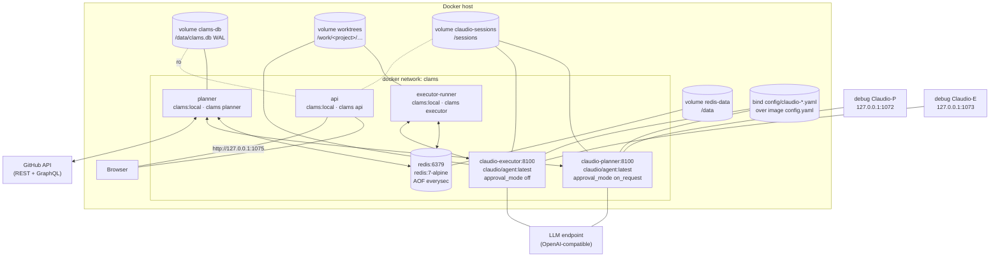
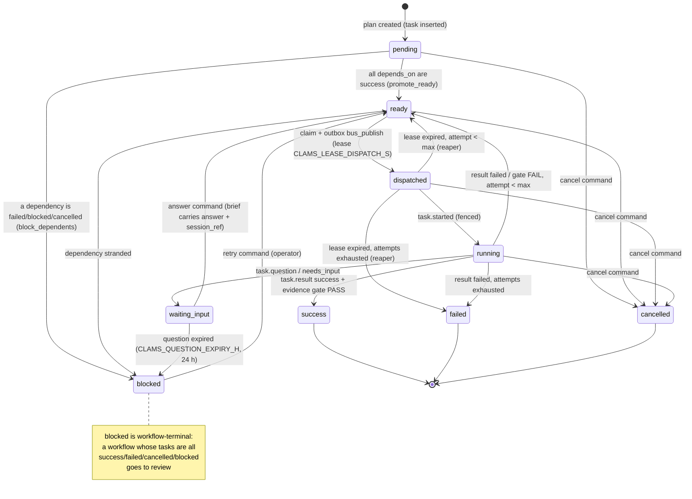
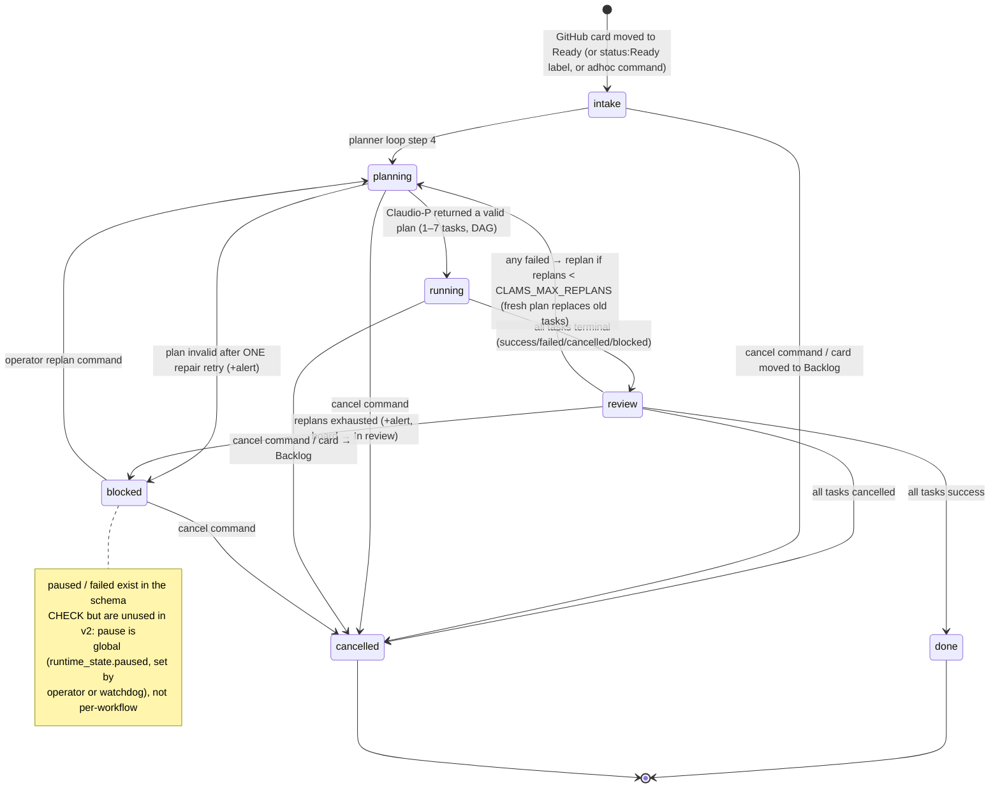

# Deployment & state machines

- [1. Topology](#1-topology)
- [2. Services, volumes, healthchecks](#2-services-volumes-healthchecks)
- [3. Scaling](#3-scaling)
- [4. Task state machine](#4-task-state-machine)
- [5. Workflow state machine](#5-workflow-state-machine)
- [6. Leases, fencing and bounds](#6-leases-fencing-and-bounds)
- [7. Watchdog](#7-watchdog)
- [8. Operational procedures](#8-operational-procedures)

---

## 1. Topology

Six containers on one docker network (`clams`), four named volumes. The
**planner is the only process that writes domain tables**; the API writes only
the `commands` inbox; executors are stateless and DB-less.

Streams: `clams:tasks` (planner → executors, group `executors`),
`clams:events` (executors → planner, group `planner`), plus an auxiliary
`clams:dlq` dead-letter stream. Losing Redis loses no work: on planner restart
`rebuild_dispatch()` re-enqueues everything from the DB.

## 2. Services, volumes, healthchecks

| Service | Image | Healthcheck | Depends on |
|---|---|---|---|
| `redis` | redis:7-alpine | `redis-cli ping` | — |
| `claudio-planner` | `${CLAUDIO_IMAGE}` | `GET :8100/healthz` | — |
| `claudio-executor` | `${CLAUDIO_IMAGE}` | `GET :8100/healthz` | — |
| `planner` | clams:local (built) | `clams healthcheck planner` (heartbeat < 60 s) | redis + claudio-planner healthy |
| `executor-runner` | clams:local | `clams healthcheck executor` (redis ping + claudio-E health) | redis + claudio-executor healthy |
| `api` | clams:local | — (compose `depends_on` planner healthy) | planner healthy |

Volumes: `clams-db` (SQLite, planner-owned; API mounts rw for the commands
insert only), `worktrees` (shared between executor-runner and claudio-executor
— this is how the agent sees the worktrees), `claudio-sessions` (agent session
state), `redis-data` (AOF). Bind mounts: `config/claudio-planner.yaml` and
`config/claudio-executor.yaml` over each container's image `config.yaml`
(the YAML wins over `CLAUDIO__*` env vars).

## 3. Scaling

One Claudio-E serves one task at a time (session isolation), so scale in
**pairs**: add `claudio-executor-N` + `executor-runner-N` to the compose file
(each runner gets its own `worktrees` mount and points at its Claudio-E via
`CLAMS_CLAUDIO_EXECUTOR_URL`). The planner is a singleton by design (single
writer). The API is stateless; run more replicas behind a proxy if needed.

## 4. Task state machine

Every transition is enforced by the table in `src/clams/db/repo_tasks.py`;
events are fenced on `(task_id, attempt, lease_token)` so a dead executor can
never corrupt state.

The **evidence gate** (executor-side, deterministic — never model text): every
`run:` command exits 0 with non-empty output; ≥1 commit on the branch; changed
files ⊆ writable globs and ∉ forbidden (a catch-all `*` in forbidden yields to
explicit writable globs); `git status --porcelain` clean. Any missing or
unparseable check ⇒ FAIL.

## 5. Workflow state machine

Global pause (`clamsctl pause` or `POST /commands {kind:pause}`): the planner
keeps draining commands, consuming events, reaping and relaying, but does no
intake/planning/dispatch. `paused_by` records `operator` vs `watchdog`; only a
watchdog pause is auto-cleared (after 3 consecutive healthy probes).

## 6. Leases, fencing and bounds

| Bound | Setting | Default |
|---|---|---|
| Dispatch lease (must be picked up) | `CLAMS_LEASE_DISPATCH_S` | 120 s |
| Running lease | extended by each heartbeat to now+`CLAMS_LEASE_RUNNING_EXTEND_S` | 180 s |
| Hard wall cap per attempt | `started_at + max_wall_s + 300` | `CLAMS_MAX_WALL_S`=1800 |
| Task attempts | `CLAMS_MAX_ATTEMPTS` | 3 |
| Workflow replans | `CLAMS_MAX_REPLANS` | 3 |
| Plan size | `CLAMS_MAX_PLAN_TASKS` | 7 |
| Question expiry → blocked | `CLAMS_QUESTION_EXPIRY_H` | 24 h |
| Outbox retries → dead | `CLAMS_OUTBOX_MAX_ATTEMPTS` | 5 (exp. backoff base 2 s) |
| Bus deliveries → DLQ | `CLAMS_DLQ_MAX_DELIVERIES` | 5 |
| Planning LLM calls / cycle | `CLAMS_PLANNING_LLM_BUDGET_PER_CYCLE` | 3 |
| Claudio call timeout | `CLAMS_CLAUDIO_TIMEOUT_S` | 120 (**set 600** — agentic planning takes minutes) |

New attempt ⇒ new `lease_token` ⇒ stale executors are fenced on every event.
The reaper returns expired-lease tasks to `ready` (or `failed` when attempts
are exhausted) and cascade-blocks their dependents.

## 7. Watchdog

Runs inside the planner process every `CLAMS_WATCHDOG_PROBE_INTERVAL_S` (30 s),
zero LLM. Probes: Redis ping, Claudio-P/E `/health`, executor liveness
(`executor.alive` events), oldest-`ready` age (`CLAMS_OLDEST_READY_ALERT_S`),
outbox dead count, DLQ length, free disk (`CLAMS_MIN_FREE_DISK_MB`), daily
SQLite integrity check. Remediation ladder: raise alert → pause dispatch
(`paused_by=watchdog`) → auto-resume after 3 healthy probes. An operator pause
is never auto-cleared.

## 8. Operational procedures

- **Backup / restore**: `./clamsctl backup` → `backups/clams-*.db`; restore by
  copying the file back into the `clams-db` volume (stack stopped).
- **Migrations**: automatic at planner boot; `./clamsctl migrate` to run
  manually. `clams status` reports `schema_version`.
- **Stuck workflow triage**: `clams status` → find `running` workflows with no
  progress; check `events` table (UI timeline); use `retry` (task),
  `replan` (workflow), or `cancel`. The loop's sweep self-heals stranded
  dependents and missed reviews every cycle.
- **Poison messages**: land in `clams:dlq` with the reason; inspect via
  `docker exec clams-redis-1 redis-cli XRANGE clams:dlq - +`.
- **Retention**: events + sent outbox pruned after 14 days, `processed_events`
  after 7 (daily, automatic).
