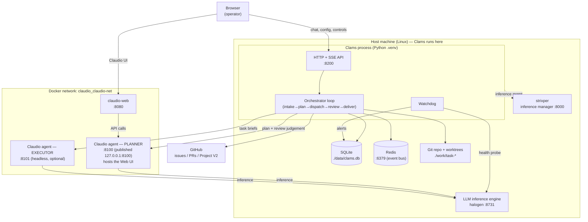
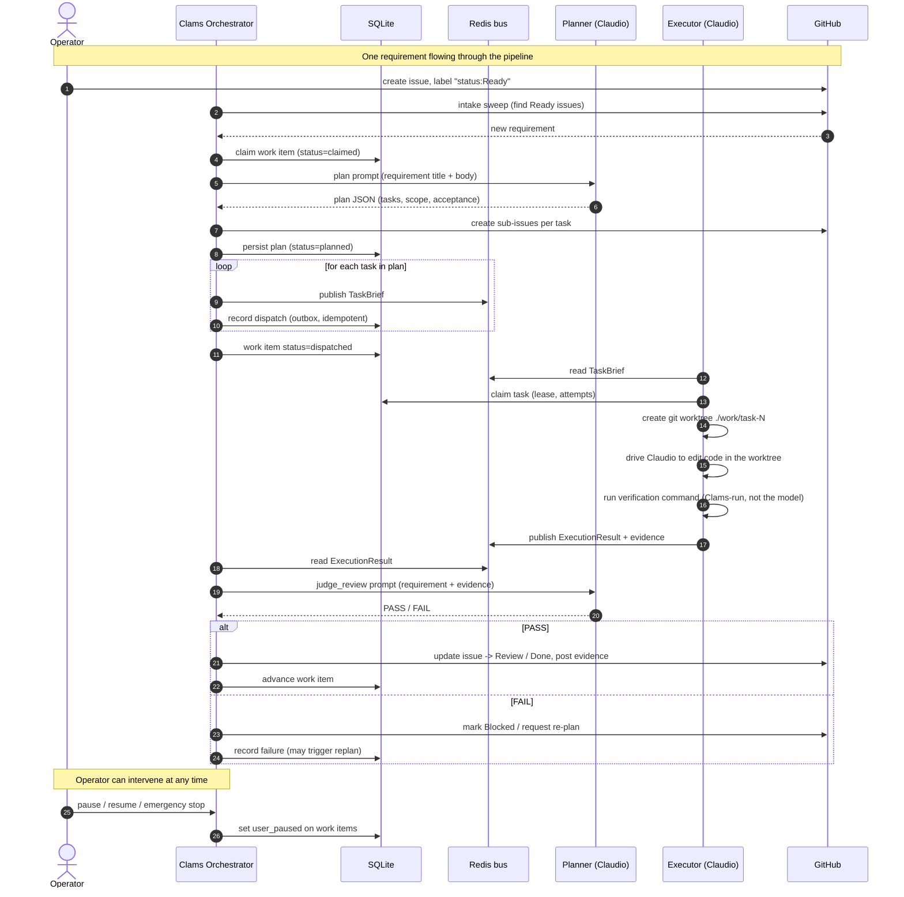
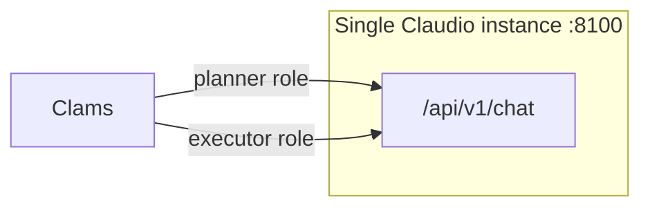

# Clams — Deployment Architecture & Claudio Workflow

**Audience:** operators deploying or operating Clams alongside a Claudio agent.
**Last updated:** 2026-11-13

This document describes (1) the deployment topology, (2) the workflow Clams runs
against a project using its agents, (3) where each agent is configured, and
(4) whether a single Claudio instance can play every agent role.

---

## 1. Roles at a glance

Clams coordinates several **roles**. Only two of them are *Claudio agent*
instances; the rest are Clams-internal Python services.

| Role | Kind | What it does | Driven via |
|---|---|---|---|
| **Planner** | Claudio agent | Decomposes a requirement into tasks, judges review evidence, answers operator chat | `CLAMS__PLANNER__*` (HTTP `/api/v1/chat`) |
| **Executor** | Claudio agent | Edits code for one task inside an isolated git worktree | `CLAMS__EXECUTOR__*` (HTTP `/api/v1/chat`) |
| **Intake** | Clams service | Pulls GitHub issues labelled *Ready* into tracked work items | `src/clams/intake.py` |
| **Review** | Clams service | Evidence gate; asks the Planner to PASS/FAIL | `src/clams/review.py` |
| **Steering** | Clams service | Applies operator commands (pause/resume/alter) | `src/clams/steering.py` |
| **Outbox** | Clams service | Delivers GitHub comments / status updates | `src/clams/outbox.py` |
| **Watchdog** | Clams service | Monitors heartbeats, disk, queues, LLM & GitHub health; raises alerts | `src/clams/watchdog.py` |

> **Key distinction:** the *Planner* and *Executor* are the two **Claudio agent**
> roles. Everything else is plain Python inside the Clams process. The "agents"
> people usually mean are the two Claudio instances.

---

## 2. Deployment architecture



**Notes on the topology**
- **Clams** (CLI + API + orchestrator) runs natively on the host in a Python venv.
- The **Planner** is the `claudio-agent` container. Its port must be published to
  the host (`127.0.0.1:8100`) so the host-run Clams can reach it.
- The **Executor** is a *second* Claudio instance (`:8101`). It is optional in the
  sense that planning works without it, but task execution requires it.
- The **LLM engine** (`:8731`) is what each Claudio instance calls internally to
    do reasoning. Clams itself only probes it (watchdog); it does not plan through
    it directly — it plans *through the Planner agent*.
- **Redis** is the event bus between the orchestrator, the executor and the
    watchdog. **SQLite** is the durable store. **GitHub** is the source of truth for
    issues and the project board.

---

## 3. The Claudio workflow (how a project is run)

Clams runs a repeating **orchestrator loop** (`settings.poll_interval` seconds).
Each cycle performs the steps below. The two Claudio agents (Planner, Executor)
are invoked at the *plan* and *execute* steps; the rest is Clams-internal.



### What each step actually does

1. **Intake** — Clams scans GitHub for issues with the *Ready* label and creates a
   tracked `work_item` (status `claimed`).
2. **Plan** — Clams sends the requirement to the **Planner** agent, which returns
   a structured plan (tasks, writable/read-only/forbidden scope, acceptance
   criteria). Clams creates a GitHub sub-issue per task and persists the plan.
3. **Dispatch** — For each planned task, Clams publishes a `TaskBrief` onto the
   Redis bus and records the dispatch idempotently in the outbox (so a crash never
   double-dispatches).
4. **Execute** — The **Executor** agent claims the task (lease + attempt cap),
   creates an isolated git worktree, edits the code there, and Clams runs the
   verification command itself so the evidence is Clams's, not the model's claim.
5. **Review** — The **Review** gate collects the evidence and asks the **Planner**
   for a one-word PASS/FAIL. Only an unambiguous PASS advances the work.
6. **Deliver** — The **Outbox** posts GitHub comments / status updates.
7. **Watchdog** — Runs alongside, watching heartbeats, disk, queue age, LLM and
   GitHub failures, and raises alerts (surfaced in the UI's Activity page).

The operator can **pause / resume / emergency-stop** at any point; that flips
`user_paused` on the work items so the loop skips them.

---

## 4. Where the agents are configured

All Clams configuration comes from **environment variables** (prefix `CLAMS__`,
nested with `__`), optionally loaded from a **`.env` file** in the repo root.
The agent connection settings are **startup config** — change them in `.env` and
restart Clams (`./scripts/dev.sh restart`). They are *not* editable from the web
Configuration page (that page only hot-edits a runtime subset).

### 4.1 Planner agent

```
CLAMS__PLANNER__BASE_URL=http://127.0.0.1:8100/api/v1   # MUST end with /api/v1
CLAMS__PLANNER__AUTH_TOKEN=<matches agent CLAUDIO__SERVER__AUTH_TOKEN>
CLAMS__PLANNER__REQUEST_TIMEOUT=120
```

Used for: planning/decomposition, review judgement, and operator chat.

### 4.2 Executor agent

```
CLAMS__EXECUTOR__BASE_URL=http://127.0.0.1:8101/api/v1
CLAMS__EXECUTOR__AUTH_TOKEN=<matches that agent's auth token>
CLAMS__EXECUTOR__EXECUTOR_ID=executor-1
CLAMS__EXECUTOR__LEASE_SECONDS=900
```

Used for: executing each task brief in a git worktree.

### 4.3 Other agent-adjacent settings

```
CLAMS__LLM__BASE_URL=http://127.0.0.1:8731            # inference engine (watchdog probe)
CLAMS__LLM__CONTAINER_BASE_URL=http://host.docker.internal:8731
CLAMS__STRIXPER__BASE_URL=http://host.docker.internal:8000
CLAMS__REDIS__URL=redis://127.0.0.1:6379/0
CLAMS__REDIS__NAMESPACE=clams
```

### 4.4 The Claudio agent's OWN configuration

Each Claudio instance is configured by its **own** environment (the
`claudio` compose file), not by Clams. The relevant ones:

```
CLAUDIO__SERVER__HOST=0.0.0.0
CLAUDIO__SERVER__PORT=8100
CLAUDIO__SERVER__AUTH_TOKEN=dev-token-change-me
CLAUDIO__SERVER__CORS_ORIGINS=["http://localhost:8080"]
CLAUDIO__LLM__BASE_URL=...        # the inference engine the agent calls
CLAUDIO__LLM__API_KEY=...
CLAUDIO__LLM__MODEL=...
CLAUDIO__AGENT__DEFAULT_WORKSPACE_DIR=/workspace
CLAUDIO__AGENT__WORKSPACE_ALLOWED_ROOTS=["/workspace", "/home/briggen/Dev/code/ai"]
CLAUDIO__AGENT__HOST_EXECUTION_ENABLED=true
CLAUDIO__AGENT__HOST_EXECUTION_SOCKET=/run/claudio-host/host-exec.sock
```

**Two tokens must agree:** the token Clams sends
(`CLAMS__PLANNER__AUTH_TOKEN` / `CLAMS__EXECUTOR__AUTH_TOKEN`) must equal the
token the agent expects (`CLAUDIO__SERVER__AUTH_TOKEN`). A mismatch shows up as
HTTP 401 on every call.

**Two paths must agree:** the agent's API is mounted under `/api/v1`, so the
Clams `BASE_URL` must include `/api/v1`.

---

## 5. Can a single Claudio instance play every agent role?

**Short answer: technically yes for the two agent roles, but it is not
recommended.** Here is the reasoning.

### 5.1 Why it is mechanically possible

Both the Planner and the Executor talk to a Claudio instance through the **exact
same contract**: `POST /api/v1/chat {message} → {final_output}`. Clams does not
care whether `CLAMS__PLANNER__BASE_URL` and `CLAMS__EXECUTOR__BASE_URL` point at
two different hosts or the **same** one. So you *can* set both to the same
instance and it will run.



### 5.2 Why it is a bad idea (the real constraints)

| Concern | Planner role | Executor role | Conflict on one instance |
|---|---|---|---|
| **Working directory** | Main repo / web-UI workspace | Per-task git worktree (`./work/task-N`) | One instance has one workspace + allowed-roots; the executor needs write access to every worktree, the planner does not |
| **Concurrency** | Interactive, low volume | Many tasks in parallel (`max_concurrent_engines`, `queues_per_engine`) | Batch execution starves interactive chat/planning; the instance's per-instance run cap throttles throughput |
| **Approval posture** | Interactive, human approvals | Headless, auto/restricted | Instance-level tool/approval defaults differ per role |
| **Failure blast radius** | If it dies, planning + chat stop | If it dies, execution stops | Shared instance = both stop together |
| **Latency** | User-facing, wants low latency | Long-running batch | Long tasks make the UI feel frozen |

### 5.3 When a single instance is acceptable

- **Single-project, low-concurrency, demo or development**: one requirement at a
  time, no parallel execution, you accept that chat is slow while a task runs.
  Point both `BASE_URL`s at the same instance and make sure its
  `WORKSPACE_ALLOWED_ROOTS` covers the worktree root.

### 5.4 Recommended topology

- **Planner instance** (`:8100`): interactive, hosts the Web UI, does planning +
  review judgement + chat.
- **One or more Executor instances** (`:8101`, `:8102`, …): headless, configured
  for the worktree roots and the verification toolchain, scaled to your
  `max_concurrent_engines`.

This keeps interactive latency, failure isolation, and throughput independent —
which is exactly why Clams models them as separate roles.

### 5.5 What you CANNOT collapse

The **Watchdog**, **Intake**, **Review**, **Steering** and **Outbox** are **not
Claudio agents** — they are Python services inside the Clams process. There is no
"Claudio instance" to point them at; they run as part of Clams. So the question
of "one instance for all agents" only ever concerns the **Planner** and
**Executor** roles.
