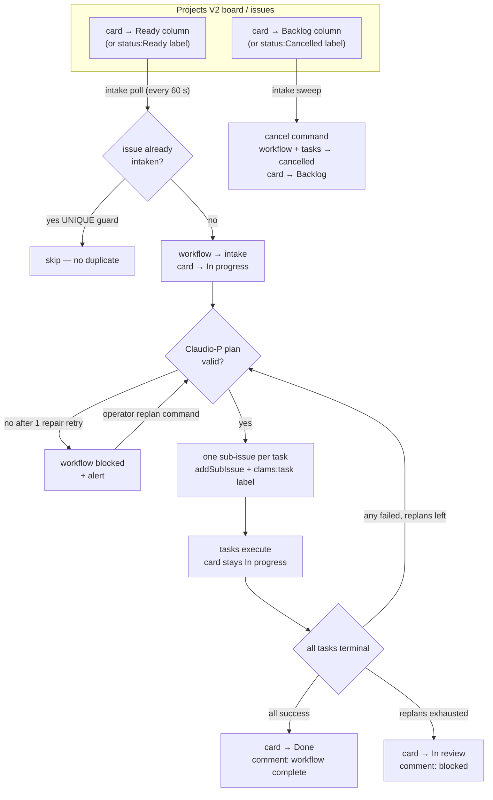

# GitHub setup — credentials, Projects V2 board, workflow

- [1. Token & scopes](#1-token--scopes)
- [2. Create the Projects V2 board](#2-create-the-projects-v2-board)
- [3. Register the project with Clams](#3-register-the-project-with-clams)
- [4. Labels Clams creates](#4-labels-clams-creates)
- [5. Workflow: gestures & projection](#5-workflow-gestures--projection)
- [6. Failure modes & verification](#6-failure-modes--verification)
- [7. Replan and sub-issue idempotency](#7-replan-and-sub-issue-idempotency)

---

## 1. Token & scopes

Clams needs a **classic PAT** with:

| Scope | Needed for |
|---|---|
| `repo` | read issues/bodies, create sub-issues, comment, push task branches |
| `project` | read **and write** the Projects V2 board (move cards) |

`read:project` is **not** enough — moving a card is a mutation, and a read-only
token fails on the first write after looking healthy. There is no
`update:project` scope; the write scope is literally `project`.

If you already use `gh` CLI:

```bash
gh auth refresh -s project
gh auth status    # scope line must include 'project'
```

Put the token in `.env` as `CLAMS_GITHUB_TOKEN=…` and recreate the planner
(`./clamsctl restart planner`). Without a token Clams still runs — GitHub
intake/projection are simply skipped (ad-hoc workflows only).

### Where the token must reach

`CLAMS_GITHUB_TOKEN` covers Clams' own API calls (intake, board projection).
Git itself needs the token in **two more places**:

- **executor-runner** pushes task branches after a passing gate
  (`src/clams/executor/worktree.py`); remotes are deliberately token-free, so
  compose mounts `config/clams-gitconfig` as `GIT_CONFIG_GLOBAL` in the clams
  containers and its credential helper feeds `$CLAMS_GITHUB_TOKEN` to git at
  push time. No extra setup — just keep `CLAMS_GITHUB_TOKEN` in `.env`.
- **Claudio agent containers** (only if the agent runs `git`/`gh` itself):
  set `GITHUB_TOKEN`/`GH_TOKEN`, the `GIT_AUTHOR_*`/`GIT_COMMITTER_*` identity
  and the credential-helper `GIT_CONFIG_*` block in `.env.claudio-executor` /
  `.env.claudio-planner` (template: `.env.claudio.example`). Without the
  identity, the agent's `git commit` fails with *"Please tell me who you are"*.
  Recreate (not just restart) after editing:
  `docker compose up -d --force-recreate claudio-executor`.

## 2. Create the Projects V2 board

1. GitHub → your repo/org → **Projects → New project → Table board** (a
   Kanban layout grouped by a **Status** single-select field).
2. The Status field **must contain options with these exact names** (the code
   matches them literally):

   | Option | Role |
   |---|---|
   | `Backlog` | inbound **cancel** gesture (move a card back here to cancel its workflow) |
   | `Ready` | inbound **enqueue** gesture |
   | `In progress` | outbound: workflow running / task dispatched |
   | `In review` | outbound: workflow in review or blocked (the board has no Blocked column) |
   | `Done` | outbound: workflow done |

3. Copy the board URL: `https://github.com/users/<you>/projects/<N>` — you need
   `<N>` (or the whole URL) for registration.

## 3. Register the project with Clams

Two ways:

**a) `config/clams.yaml`** (static, applied at planner boot):

```yaml
projects:
  - repo: owner/repo
    enabled: true
    base_ref: main
    gh_project_number: 2      # 0 = board disabled → label-driven project
    status_field: Status
```

**b) `config_patch` command** (live, no restart) — Clams resolves the board URL
to GraphQL node ids (`gh_project_node_id`, `status_field_id`, `ready_option_id`)
and stores them in the `projects` table:

```bash
curl -X POST http://localhost:1075/api/v1/commands \
  -H "Authorization: Bearer $CLAMS_API_TOKEN" -H 'Content-Type: application/json' \
  -d '{"kind":"config_patch","payload":{"projects":[{"repo":"owner/repo","enabled":true,"base_ref":"main","gh_board_url":"https://github.com/users/you/projects/2"}]}}'
```

A project **without** a board (`gh_project_number: 0`) is label-driven:
`status:Ready` label enqueues, `status:Cancelled` cancels.

## 4. Labels Clams creates

`ensure_label` auto-creates them on the repo: `status:Ready`,
`status:In Progress`, `status:Review`, `status:Blocked`, `status:Done`,
`status:Cancelled`, and `clams:task` (marks Clams' own sub-issues — they are
**never** re-decomposed).

## 5. Workflow: gestures & projection

Only **two inbound gestures** are honoured (label is truth for machine state);
everything else is outbound projection via the idempotent outbox relay.



Projection details:

- **Sub-issues**: created per task via GraphQL `addSubIssue`, labelled
  `clams:task` + `status:In Progress`; task state changes move their labels
  (success→`status:Done`, failed→`status:Blocked`, waiting_input→`status:Review`).
- **Comments** (question asked, workflow done/blocked) embed an
  `<!-- gh:…:idempotency-key -->` marker so a relay crash between the GitHub
  call and the mark-sent never duplicates a comment.
- **Rate limits**: the client honours `Retry-After` / secondary-limit headers.
- **Budget**: intake polls every 12 planner cycles (60 s); at most 3 planning
  LLM calls per cycle.

## 6. Failure modes & verification

| Symptom | Cause / fix |
|---|---|
| Cards never move, no error | token missing `project` scope → `gh auth refresh -s project` |
| `intake board sweep failed` in planner log | board URL/number wrong, or Status option names differ from the table above |
| Sub-issues missing on old workflows | fixed in `372db6a`/`a991ac4` — rebuild the planner |
| 403 secondary rate limit | Clams backs off automatically; reduce polling by raising `CLAMS_INTAKE_EVERY_N_CYCLES` |
| Verify live | `docker exec clams-planner-1 sqlite3 /data/clams.db "SELECT gh_project_node_id,status_field_id,ready_option_id FROM projects;"` — all three non-NULL for a board project |


## 7. Replan and sub-issue idempotency

**Invariant: a replan reconciles by `plan_key`, never by `task_id`.** Unchanged
tasks keep their sub-issue, removed tasks get their sub-issue closed, and only
genuinely new tasks create one.

Concretely, for a workflow whose parent issue exists (`workflows.gh_issue_number`
is set):

| Plan entry after the replan | Task row | GitHub sub-issue |
|---|---|---|
| title still in the plan | `UPDATE`d in place — same `task_id`, same `gh_issue_number` | untouched, no new outbox row |
| title no longer in the plan | `cancelled` (never `DELETE`d) | exactly one `gh_close` for its issue |
| title not seen before | inserted | exactly one `gh_subissue` (`:created`) |

`plan_key` is `repo_tasks.normalize_plan_key(title)` — title stripped, internal
whitespace runs collapsed, casefolded (`'  Fix   Replan Dedupe '` →
`'fix replan dedupe'`). The title is the one field the planner reproduces across
replans, which is what makes it usable as a stable identity.

Why the key matters: the outbox dedupes sub-issue projections on
`gh:gh_subissue:<task_id>:created`. A replan that deletes and re-inserts task
rows mints a fresh `task_id` for identical work, so that key looks never-seen and
GitHub mints a duplicate sub-issue. Reconciling by `plan_key` keeps the
`task_id` — and therefore the idempotency key — stable, so a replan of an
unchanged plan enqueues nothing at all.

Guarantees this buys:

- **N replans of the same plan produce 1 sub-issue per task.** Re-running
  `apply_replanned_plan` with the same titles is a no-op for projection
  (`project_tasks_created` returns 0).
- **No orphans.** The number of `gh_subissue` `:created` rows equals the number
  of distinct `plan_key`s ever planned, and every still-open sub-issue belongs to
  a live task.
- **Idempotent on retry.** Both `project_tasks_created` and
  `project_tasks_superseded` dedupe on their outbox key, so a planner crash
  between enqueue and send cannot double-project.

Enforced by `tests/unit/test_replan_no_duplicate_issues.py` (regression test for
issue #133, where a parent issue accumulated ~27 mostly-duplicated children).
See `reports/replan_duplicate_issues_fix.md`.
