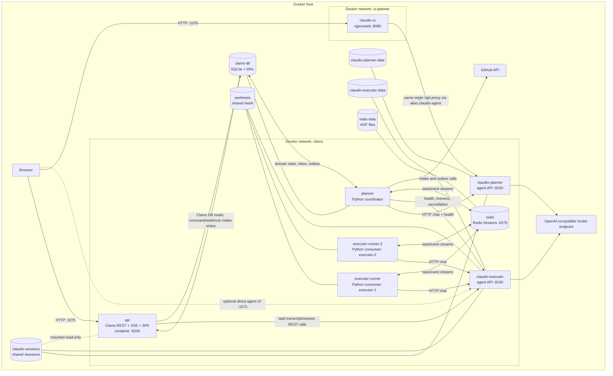

# Clams deployment and system architecture

This document describes the deployment defined by [`docker-compose.yml`](../docker-compose.yml)
and the behavior implemented by the Clams Python services. It is intended to
answer two related questions:

1. What runs in each container, and how do the containers communicate?
2. Why does the Python `executor` call a separate Claudio executor agent?

The Compose file is the source of truth for service names, ports, networks, and
mounts. Some older deployment notes describe a smaller stack; use this guide
for the current Compose topology.

## 1. The short answer: two executor layers

“Executor” refers to two separate components:

- **Clams Python executor-runner** (`executor-runner` and
  `executor-runner-2`) is the queue consumer and task orchestrator. It reads a
  task message, checks and prepares its Git worktree, calls Claudio-E over
  HTTP, supervises the task lifecycle, runs deterministic verification, and
  reports a result. It is deliberately stateless and has no database
  connection.
- **Claudio-E** (`claudio-executor`) is the agent runtime. It receives the
  prompt and workspace path, runs the configured agent/model/tool loop, and
  edits the source tree. It does not decide Clams task status or write Clams'
  task database.

The Python runner does not implement the coding agent or call the LLM directly.
It is the controlled bridge between Clams' durable workflow machinery and
Claudio's agent API. Keeping the roles separate lets Clams enforce task
leases, retries, workspace isolation, scope rules, evidence checks, and
workflow state transitions independently of model output.

The **Planner** has the same separation: the Clams `planner` process owns
workflow state and invokes **Claudio-P** to produce or repair a plan. The
planner validates that plan, while completion review and replan decisions use
Clams' deterministic task states and evidence; Claudio-P does not judge task
success.

## 2. Deployment overview

The normal Compose deployment has eight service containers:

| Service | Image / command | Purpose |
|---|---|---|
| `redis` | `redis:7-alpine` | Durable Redis Streams transport for task dispatch and executor events; AOF persistence is enabled. |
| `claudio-planner` | `${CLAUDIO_IMAGE}` (default `claudio/agent:latest`) | Claudio agent backend used by the Clams planner for decomposition and planning. |
| `claudio-executor` | `${CLAUDIO_EXECUTOR_IMAGE}` (default `claudio/agent-exec:latest`) | Claudio agent backend used by Python executor-runners to do task work. |
| `claudio-ui` | `${CLAUDIO_WEB_IMAGE}` (default `claudio/web:latest`) | Separate Claudio web UI on port 1076; its default backend is the planner agent. |
| `planner` | `clams:local`, `clams planner` | Singleton workflow coordinator and sole writer of Clams domain state. |
| `executor-runner` | `clams:local`, `clams executor` | Python task runner, consumer identity `executor-1`. |
| `executor-runner-2` | `clams:local`, `clams executor` | Second Python task runner, consumer identity `executor-2`. |
| `api` | `clams:local`, `clams api` | Clams REST API, SSE event feed, and embedded Clams SPA. |

`clams:local` is built from the repository's root `Dockerfile`. That
multi-stage build compiles the frontend SPA and packages it into the Clams
image served by `api`. The Claudio web UI is a different image and service.

The Claudio images are external to that build. `docker-compose.yml` sets
`pull_policy: never` for them, so the required images must already be present
locally. The executor image can be built from
[`docker/claudio-exec/Dockerfile`](../docker/claudio-exec/Dockerfile), which
extends the stock Claudio agent image with pytest dependencies used by
verification commands.

### Container and network topology



In the diagram, external endpoints are shown alongside the Docker host for
context; GitHub and the model endpoint are not Compose containers. The two
executor-runner services share one Claudio-E backend and the same `/work`
volume. Each runner processes one task at a time; the two distinct runner
identities provide two consumer slots in this deployment.

## 3. Responsibilities and trust boundaries

### Clams planner

The `planner` process is the central coordinator and only writer of workflow,
task, and runtime domain state. Its loop:

1. Drains operator/API commands and GitHub webhook commands.
2. Polls enabled GitHub repositories or Projects V2 boards for intake.
3. Calls Claudio-P to plan or replan; validates the returned plan and task
   dependency graph before saving it.
4. Promotes tasks whose dependencies have succeeded and schedules dispatch.
5. Consumes executor events and applies them transactionally with fencing and
   deduplication.
6. Runs liveness checks, lease recovery, question expiry, and workflow review.
7. Relays durable outbox items to Redis or GitHub.
8. Runs watchdog probes and updates the planner heartbeat.

The planner is intentionally a singleton because it owns SQLite writes. It
communicates with Redis and the agent containers over HTTP / Redis Streams.

### Clams Python executor-runner

The Python runner does not open SQLite. For each task dispatch it:

1. Parses and validates the message; handles unsupported or poison messages
   and sends over-retried messages to the dead-letter stream.
2. Creates or reuses a repository clone and an isolated Git worktree/branch
   for that task attempt under `/work`.
3. Emits `task.started`, then calls Claudio-E's `POST /api/v1/chat` with the
   rendered task prompt, a unique session ID, `approval_mode=off`, and the
   worktree path as the workspace.
4. Emits heartbeats while the call is running. It also emits an executor
   liveness event independently of the active task.
5. If the agent requests human input, emits `task.question`. Otherwise, runs
   the evidence gate in the worktree.
6. On gate success, pushes the task branch and advances the workflow's local
   integration ref; on failure, leaves the attempt worktree for inspection.
7. Emits a `task.result` event and acknowledges the Redis dispatch only after
   the result/question has been published.

The Python runner is therefore both **adapter** (Clams task contract to
Claudio HTTP contract) and **policy enforcement point** (worktree setup,
verification, evidence reporting). It does not treat the agent's final prose
as proof of success.

### Claudio-P and Claudio-E

These are separate agent-backend instances with different configs:

- **Claudio-P** receives planning/replanning prompts from the planner. Its
  returned plan is parsed and validated by Clams before tasks are written.
- **Claudio-E** receives task prompts from executor-runners. Its agent tools
  operate inside the provided `/work/...` workspace. In the deployed config,
  host execution is disabled; the agent runs within its container and shares
  the worktree mount with the Python runner.

Both use an OpenAI-compatible model endpoint configured in their mounted agent
configuration. Their requests to that model endpoint do not pass through
Redis. The agent containers expose an HTTP API on container port 8100.

### Clams API and two web interfaces

- **Clams UI/API**: `api` serves the Clams SPA and `/api/v1` routes on
  container port 8200, published as host port **1075**. The API reads Clams
  state and inserts command-inbox rows; the GitHub webhook endpoint validates
  and records webhook deliveries before queuing a command. The planner applies
  commands to domain state.
- **Claudio UI**: `claudio-ui` is a separate web application on host port
  **1076**. Its nginx `/api` upstream resolves the `claudio-agent` network
  alias to Claudio-P by default. The UI can be configured for direct access to
  Claudio-E on host port **1073**.

The agent backend ports **1072** (Planner) and **1073** (Executor) are also
published for diagnostics/direct UI access. The API, runner, planner, Redis,
and agent backends communicate over the internal `clams` network using service
DNS names. Redis has no host-published port.

## 4. Task communication and lifecycle

Redis is transport, not the source of truth. SQLite stores Clams task/workflow
state and the outbox. The planner enqueues a `bus_publish` outbox row in the
same transaction as dispatch; the planner's relay later publishes that message
to `clams:tasks`. Executor-runners publish task lifecycle events to
`clams:events`; the planner consumes and applies them to SQLite. The auxiliary
`clams:dlq` stream holds poison or over-delivered messages.

```mermaid
sequenceDiagram
    participant GH as GitHub
    participant P as Clams planner
    participant DB as SQLite clams-db
    participant R as Redis Streams
    participant X as Python executor-runner
    participant W as Shared /work volume
    participant CP as Claudio-P
    participant A as Claudio-E
    participant L as Model endpoint

    GH-->>P: Issue or project status found by intake poll
    P->>DB: Create workflow and record state
    P->>CP: Chat to plan workflow
    CP->>L: Model/tool reasoning
    CP-->>P: Plan text
    P->>P: Parse and validate task DAG
    P->>DB: Persist tasks and bus_publish outbox row
    P->>R: XADD task dispatch via outbox relay
    R-->>X: XREADGROUP clams:tasks
    X->>W: Clone/update repository; create attempt worktree
    X->>R: XADD task.started
    X->>A: POST /api/v1/chat with prompt, session and workspace
    A->>W: Agent tools edit, test and commit task changes
    A->>L: Model requests as needed
    A-->>X: Final output
    X->>W: Run evidence gate and inspect Git state
    alt Evidence passes
        X->>W: Push task branch and update workflow integration ref
        X->>R: XADD task.result success with evidence
    else Agent needs human input
        X->>R: XADD task.question
    else Evidence or infrastructure fails
        X->>R: XADD task.result failed with evidence
    end
    X->>R: XACK dispatch after event publish
    R-->>P: XREADGROUP clams:events
    P->>DB: Apply fenced event and update state
    P->>DB: Review task states/evidence; enqueue GitHub outbox effects
    P->>GH: Relay comments, labels, project moves, etc.
```

### Why the runner, rather than Claudio, owns verification and task state

Claudio's response describes the agent run, but it is not the authoritative
task result. The runner independently checks the task's requested `run:`
commands, commit count, changed-file scope, and clean worktree. It sends those
results as structured evidence. The planner then owns the database transition,
including deciding whether the task succeeded, should be retried, needs input,
or exhausted its attempts.

This boundary also means that:

- A model cannot mark a task successful just by claiming it did the work.
- A Claudio outage is reported as an infrastructure failure, not mistaken for
  a code-level failure.
- A restarted runner can replay pending Redis messages; lease tokens and
  planner-side fencing prevent stale events from overwriting a newer attempt.
- The runner can be replicated without granting every worker a database
  credential or write path.

## 5. Storage, mounts, and durable state

| Volume / mount | Mounted in | Contents and role |
|---|---|---|
| `clams-db` at `/data` | `planner`, `api` | SQLite database and WAL. Planner owns domain writes. API has read access plus writes for command/webhook intake. |
| `redis-data` at Redis `/data` | `redis` | Redis append-only persistence for Streams. |
| `worktrees` at `/work` | both executor-runners and `claudio-executor` | Shared clones, task worktrees, Git refs, and agent-visible files. This shared mount is how agent edits are visible to the Python evidence gate. |
| `claudio-sessions` at `/sessions` | both Claudio backends; read-only in `api` | Shared agent session storage mount. |
| `claudio-planner-data` | `claudio-planner` backend data directory | Planner agent's transcripts and backend data. |
| `claudio-executor-data` | `claudio-executor` backend data directory | Executor agent's transcripts and backend data. |
| `config/agents/planner` bind mount | `claudio-planner` config directory | Planner agent config, model endpoint, auth, tools, and workspace policy. |
| `config/agents/executor` bind mount | `claudio-executor` config directory | Executor agent config, model endpoint, auth, tools, and allowed workspaces. |
| `config/clams-gitconfig` read-only bind mount | both executor-runners | Git credential-helper configuration for task-branch pushes. |

The Python API's transcript endpoint uses Claudio's session HTTP API. The
read-only `/sessions` mount is present in Compose but does not make the API a
writer or task-state owner.

Deleting Compose containers without `down -v` preserves named volumes. Removing
volumes removes the corresponding persisted data; in particular, removing
`clams-db` loses Clams state, while removing Redis data alone is recoverable
from the database and planner dispatch recovery.

## 6. Networks, ports, and request paths

| Host port | Container target | Service | Purpose |
|---:|---|---|---|
| `1072` | `claudio-planner:8100` | `claudio-planner` | Planner agent health/chat API; debugging access. |
| `1073` | `claudio-executor:8100` | `claudio-executor` | Executor agent health/chat API; optional direct Claudio UI backend. |
| `1075` | `api:8200` | `api` | Clams SPA, REST API, SSE, and GitHub webhook route. Bound on all host interfaces by Compose. |
| `1076` | `claudio-ui:8080` | `claudio-ui` | Claudio browser UI; default backend is the planner agent. |
| none | `redis:6379` | `redis` | Internal Redis Streams only. |

The `clams` Docker network carries planner/API/runner/agent/Redis traffic. The
`ui-planner` network connects the Claudio UI to Claudio-P; the planner
container has the `claudio-agent` alias there, matching the web image's
expected upstream. The UI is not connected to the Redis network.

The Clams containers receive internal service URLs through Compose
environment overrides: `redis://redis:6379/0`,
`http://claudio-planner:8100`, and `http://claudio-executor:8100`. These
container URLs are different from host-published ports used by a browser.

## 7. Scaling and recovery

- The planner remains a singleton because it is the SQLite domain-state
  writer.
- Each executor-runner handles work sequentially. The current deployment has
  two runners, each with a distinct executor ID, sharing Redis, `/work`, and
  Claudio-E. `executor_capacity` controls how many messages are prefetched; it
  does not make one runner execute tasks concurrently.
- More independent capacity requires additional runner consumers and enough
  capacity at the model/agent endpoint. A runner should have its own unique
  `CLAMS_EXECUTOR_ID`.
- The API is stateless with respect to domain ownership and can be replicated
  behind a proxy if all replicas are configured for the same database and
  token.
- Redis Streams use consumer groups and pending-entry recovery. On planner
  restart, dispatch can be rebuilt from SQLite; therefore Redis loss is queue
  transport loss, not loss of the canonical task records.
- The watchdog runs inside the planner. It probes Redis, Claudio health,
  executor heartbeats, queue age, dead outbox entries, disk/database health,
  and the model endpoint. Critical failures can pause dispatch. A frozen agent
  raises an alert; the watchdog does not kill a task just because it is slow.

## 8. Configuration and deployment lifecycle

There are three important configuration surfaces:

1. **Clams environment** (`.env`, loaded by `clams` containers): database and
   work paths, Redis URL, agent URLs/tokens, API token, GitHub token, executor
   identity, lease/watchdog settings.
2. **Clams project configuration** (`config/clams.yaml`): enabled repositories,
   base refs, and project-level configuration. Clams settings and environment
   values are validated at startup.
3. **Agent configuration** (`config/agents/planner` and
   `config/agents/executor`, mounted into Claudio): model endpoint and
   credentials, agent instructions/tools, auth token, approval mode, and
   allowed workspace roots. The directory is mounted so Claudio can safely
   persist config edits.

The Claudio backend bearer tokens in its mounted config must match the
corresponding `CLAMS_CLAUDIO_*_TOKEN` used by Clams. The Clams API token is a
separate credential; GitHub credentials and model endpoint credentials are
separate again. Do not copy secret values into architecture documentation.

`./clamsctl start` starts the Compose stack and waits for service health.
`./clamsctl rebuild` pulls available base images, builds `clams:local`, and
recreates the services. The local Claudio backend/UI images must be built or
provided separately before this stack can use them. `./clamsctl down` removes
containers but keeps volumes; `./clamsctl nuke` removes volumes and is
destructive.

The older [deployment and state-machine guide](deployment.md) covers workflow
and task transitions, retry behavior, lease details, watchdog policy, and
operator procedures. This document is the current reference for Compose
topology and component communication.
